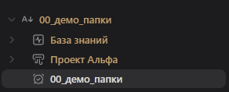

# AVM Folder Notes

> Плагин для Obsidian, реализующий архитектуру папок-документов (Folder Notes) и систему векторных иконок для проводника, вкладок, заголовков и закладок в экосистеме Ave Maria.

---

## Возможности

- **Папки-документы (Notion-style):** Клик по названию папки в проводнике открывает титульную заметку (или создаёт её при отсутствии). Сворачивание и раскрытие дерева по стрелочке сохраняется на 100% нативным.
- **Гибкие форматы именования:** Поддержка стратегий `Папка/Папка.md` и настраиваемых индексных файлов (`Папка/index.md`).
- **Стили индикации с предпросмотром:** 4 визуальных стиля маркировки папок с заметками (золотая точка, цвет заголовка, мини-бейдж `[DOC]`, тонкое подчеркивание) с интерактивным предпросмотром в настройках.
- **Векторная система иконок:**
  - Полный охват интерфейса: папки и файлы проводника, вкладки заметок (Tabs), заголовки документов (Inline title), боковая панель закладок (Bookmarks) и боковой риббон.
  - Поддержка системной библиотеки иконок Lucide из ядра Obsidian.
  - Автоматическое сканирование и загрузка локальных SVG-файлов из настраиваемой папки хранилища.
- **Встроенная студия загрузки SVG:** Загрузка собственных файлов `.svg` прямо через интерфейс настроек с галереей миниатюр и быстрым удалением.
- **Безопасность данных:** Автоматическая синхронизация имён заметок и привязок иконок при переименовании или перемещении папок и файлов.
- **Двуязычный интерфейс:** Полная локализация (Русский / English) с мгновенным переключением.

---

## Интерфейс

### Навигация и индикация в проводнике


---

## Установка

### Вариант 1. Через AVM Nexus (Рекомендуется)
1. Установите лаунчер **[AVM Nexus](https://github.com/loklp42/obsidian-avm-nexus)**.
2. В разделе **Экосистема AVM** найдите карточку **AVM Folder Notes** и нажмите **Установить**.
3. Плагин загрузится и активируется мгновенно в один клик.

### Вариант 2. Через плагин BRAT
1. Установите и включите плагин **BRAT** (Beta Reviewers Auto-update Tester) в Obsidian.
2. Откройте командную палитру (`Ctrl + P`) и выберите:
   `BRAT: Add a beta plugin for testing`
3. Вставьте ссылку на репозиторий:
   ```text
   https://github.com/loklp42/obsidian-avm-folder-notes
   ```
4. Нажмите **Add Plugin** — BRAT автоматически скачает последнюю версию и будет отслеживать будущие обновления.
5. Включите **AVM Folder Notes** в разделе **Настройки → Сторонние плагины**.

### Вариант 3. Вручную
1. Скачайте файлы `main.js`, `manifest.json`, `styles.css` из последнего релиза.
2. Поместите их в папку вашего хранилища:
   ```text
   <Vault>/.obsidian/plugins/obsidian-avm-folder-notes/
   ```
3. Перезагрузите Obsidian (`Ctrl + P` → *Reload app without saving* или `Ctrl + R`).
4. Включите плагин в разделе **Настройки → Сторонние плагины**.

---

## Сборка

```bash
npm install
npm run build
```

---

## Лицензия

[MIT](LICENSE)

---

# AVM Folder Notes (English)

> An Obsidian plugin implementing folder-as-document architecture (Folder Notes) and vector icons management for explorer, tabs, headers, and bookmarks in the Ave Maria ecosystem.

---

## Features

- **Folder Notes (Notion-style):** Clicking a folder title in the file explorer opens its title note (or creates one if missing). Collapsing and expanding via arrows remains 100% native.
- **Flexible Naming Strategies:** Support for `Folder/Folder.md` and customizable index files (`Folder/index.md`).
- **Indicator Styles with Live Preview:** 4 visual indicator styles for folders with notes (golden dot, title color, mini badge `[DOC]`, subtle underline) with real-time preview in settings.
- **Vector Icon Engine:**
  - Complete interface coverage: explorer folders and files, editor tabs, note inline titles, bookmarks panel, and side ribbon dock.
  - Native Lucide icons support from Obsidian core.
  - Automatic indexing and loading of local SVG files from a configurable vault directory.
- **Built-in SVG Upload Studio:** Upload custom `.svg` files directly via the settings UI with a visual thumbnail gallery and one-click removal.
- **Data Safety:** Automatic synchronization of note names and icon mappings when renaming or moving folders and files.
- **Bilingual Interface:** Full localization (Russian / English) with instant switching.

---

## Interface

### Explorer & Folder Notes


---

## Installation

### Option 1. Via AVM Nexus (Recommended)
1. Install **[AVM Nexus](https://github.com/loklp42/obsidian-avm-nexus)** launcher.
2. Under **AVM Ecosystem**, locate **AVM Folder Notes** and click **Install**.
3. The plugin will be fetched and activated instantly in one click.

### Option 2. Via BRAT
1. Install and enable the **BRAT** (Beta Reviewers Auto-update Tester) plugin in Obsidian.
2. Open the Command Palette (`Ctrl + P`) and run:
   `BRAT: Add a beta plugin for testing`
3. Enter the repository link:
   ```text
   https://github.com/loklp42/obsidian-avm-folder-notes
   ```
4. Click **Add Plugin** — BRAT will automatically fetch the latest release and check for future updates.
5. Enable **AVM Folder Notes** under **Settings → Community plugins**.

### Option 3. Manual Installation
1. Download `main.js`, `manifest.json`, and `styles.css` from the latest release.
2. Place them into your vault folder:
   ```text
   <Vault>/.obsidian/plugins/obsidian-avm-folder-notes/
   ```
3. Reload Obsidian (`Ctrl + P` → *Reload app without saving* or `Ctrl + R`).
4. Enable the plugin under **Settings → Community plugins**.

---

## Build

```bash
npm install
npm run build
```

---

## License

[MIT](LICENSE)
